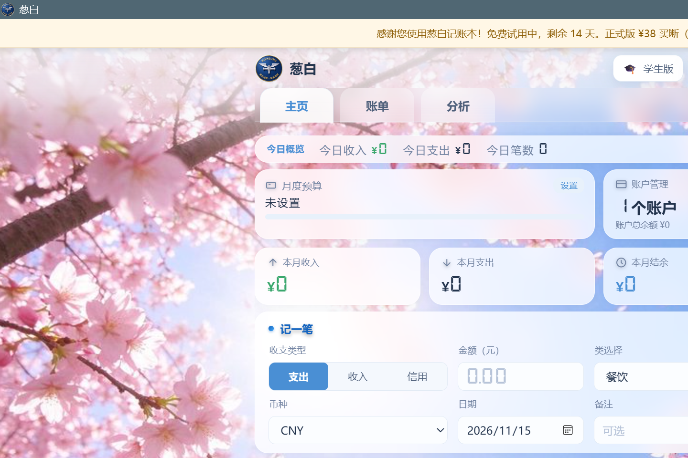
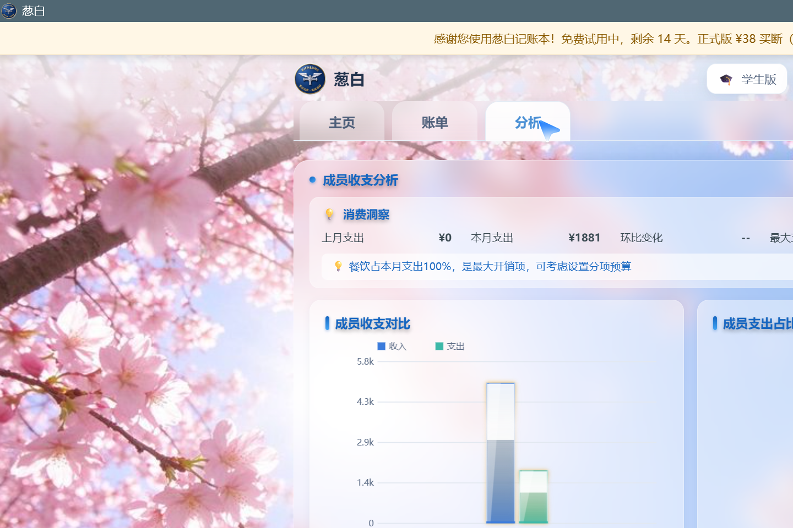
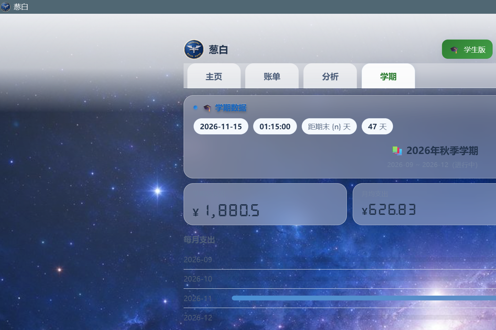

# 葱白记账本 · CongBai Ledger

完全离线的 Windows 个人记账软件 · 不联网 · 不上传 · 隐私至上

Fully offline personal finance app for Windows — no internet, no tracking, privacy first.

---

## ✨ 功能特性 · Features

| 中文 | English |
|---|---|
| 收支记账、预算管理、财务图表分析 | Income/expense tracking, budgets, analytics charts |
| 学生模式：学期视图、AA平摊、校园分类 | Student mode: semester view, AA split, campus categories |
| 7种界面语言（中/英/日/韩/俄/法） | 7 UI languages (CN/EN/JP/KO/RU/FR) |
| 9张背景主题 + 7套配色方案 | 9 wallpapers + 7 color themes |
| 应用锁：密码或手势保护 | App lock: password or gesture pattern |
| 账单导入（微信/支付宝/银行CSV） | Bill import (WeChat/Alipay/bank CSV) |
| 数据完全本地存储，零上传 | 100% local storage, zero upload |

## 📸 界面预览 · Screenshots

## 🚀 下载 · Download

- 国内用户：[百度网盘](https://pan.baidu.com/s/1__GiL13-seXMD3twBpufYg?pwd=r2rb)（提取码：r2rb）
- 国际用户：[GitHub Releases](https://github.com/kienlung062-cpu/congbai-ledger/releases)

## 💻 系统要求 · Requirements

- Windows 10 / 11 (64-bit)
- WebView2 Runtime（通常已内置 / usually pre-installed）

## 🔐 隐私 · Privacy

本软件完全离线运行，不联网、不上传、不收集任何个人数据。所有账本数据仅存储在您的本地电脑中。

This app runs fully offline. No internet, no uploads, no data collection.

[隐私政策 / Privacy Policy](https://kienlung062-cpu.github.io/privacy.html)

## 📜 版权 · License

Copyright (c) 2026 Kienlung. All rights reserved.

葱白记账本为 Kienlung 开发的专有软件，受《中华人民共和国著作权法》保护。

## ⚠️ 免责声明 · Disclaimer

本软件按"现状"提供，不提供任何明示或暗示的担保。使用者应自行备份重要数据。

Provided "as-is" without warranty. Users should back up important data regularly.

## 📧 联系 · Contact

catkvc@163.com